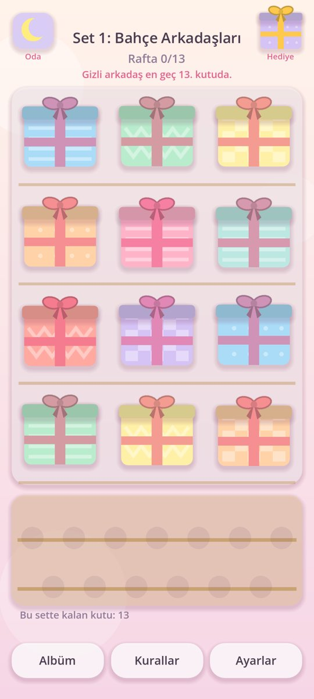
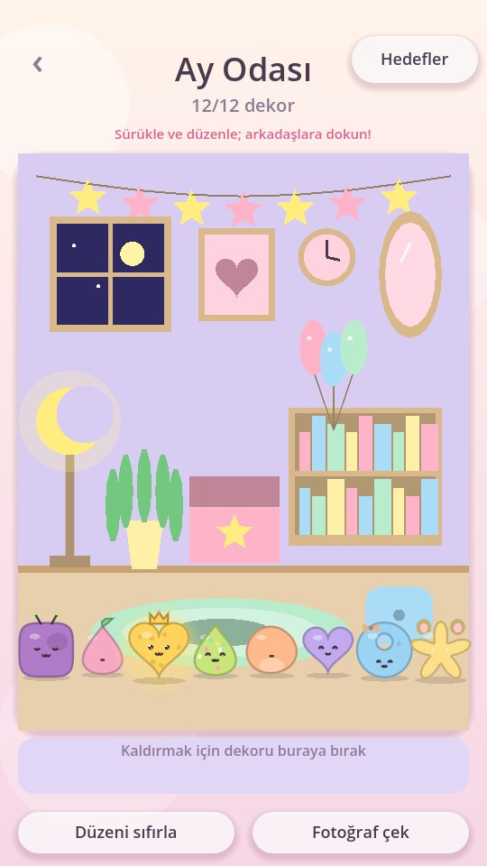
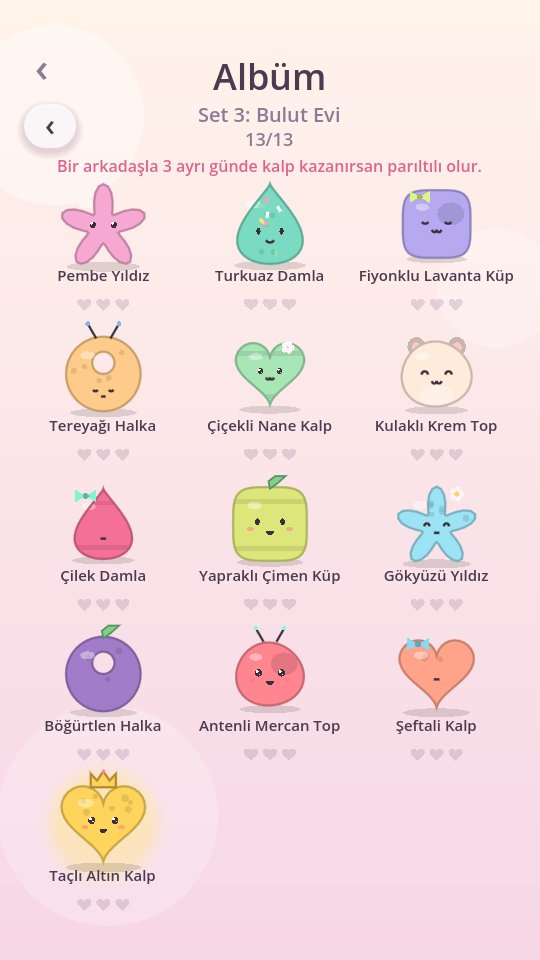
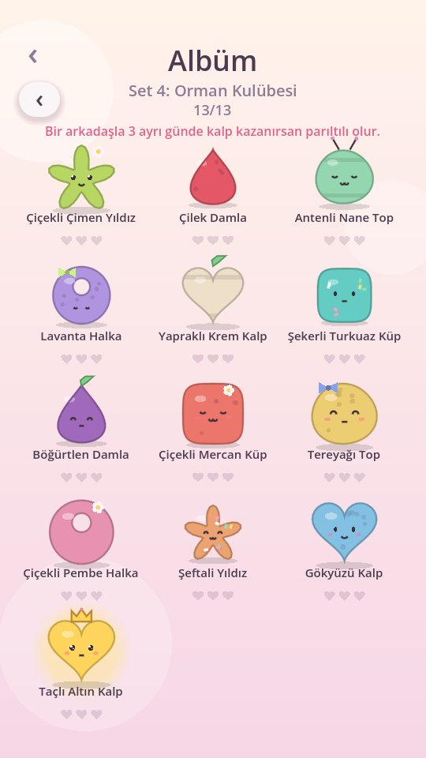

# Unboxlune: Cozy Unbox ASMR

A calm box-opening game for the whole family. Open gift boxes with satisfying gestures, meet squishy friends, dress them up and give them a cosy Moon Room. Every set is complete in 13 boxes with no duplicates, and new sets never run out.

[Türkçe](#türkçe) · [Privacy policy](privacy.md)

  
  
  
  

## Download

- **Android:** coming to Google Play.

## Features

- **No duplicates:** every box holds a new friend. A set is exactly 13 boxes, and the rules page tells you the odds of the secret friend.
- **Many ways to open:** pull a ribbon, peel tape, zip, stick; then tear, pop bubbles, twist or lift a lid. Soft sounds and gentle vibration.
- **Friends with personality:** each friend enters in its own way, has its own voice and squishes when you press it.
- **Dress-up:** 12 accessories, earned by playing (nothing is sold).
- **Moon Room:** 12 decorations to arrange, a night mode, goals with accessory gifts, a storage shelf and a button that saves a photo of your room.
- **Endless sets:** after the first set, new sets with new colors and names keep coming.
- **Comfort for small hands:** the game asks for an age range once and becomes more forgiving for younger players.
- English and Turkish.

The game is free and shows few ads from Google AdMob, never while opening boxes. Younger players get child-directed, non-personalized ads only. A one-time "Remove ads" purchase (behind a grown-up gate) takes them away.

## Support

luneapps.support@gmail.com

Built with Godot Engine (MIT license). The art and sound were generated in code for this game.

This repository holds the documentation only; the source code is not published here.

---

## Türkçe

# Unboxlune: Kutu Aç, Biriktir

Bütün aileye uygun, sakin bir kutu açma oyunu. Hediye kutularını tatmin edici hareketlerle aç, yumuşak arkadaşlarla tanış, onları giydir ve rahat bir Ay Odası kur. Her set tam 13 kutudur, kopya yoktur ve yeni setler hiç bitmez.

[Gizlilik politikası](privacy.md)

### Özellikler

- **Kopya yok:** her kutuda yeni bir arkadaş var. Bir set tam 13 kutudur; gizli arkadaşın olasılığını kurallar sayfası söyler.
- **Çok çeşit açılış:** kurdele çek, bandı sök, fermuarı aç, çıkartmayı soy; sonra yırt, balonları patlat, kapağı çevir ya da kaldır. Yumuşak sesler ve hafif titreşim.
- **Kişilikli arkadaşlar:** her biri kendi tarzında girer, kendi sesi vardır ve bastığında ezilir.
- **Giydirme:** oynayarak kazanılan 12 aksesuar (satılan bir şey yok).
- **Ay Odası:** düzenlenecek 12 dekor, gece modu, aksesuar armağan eden hedefler, depo şeridi ve odanın fotoğrafını kaydeden bir düğme.
- **Sonsuz setler:** ilk setten sonra yeni renk ve adlarla yeni setler gelmeye devam eder.
- **Küçük eller için rahatlık:** oyun bir kez yaş aralığını sorar ve küçük oyunculara karşı daha hoşgörülü olur.
- Türkçe ve İngilizce.

Oyun ücretsizdir ve Google AdMob'dan az sayıda reklam gösterir; kutu açarken asla. Küçük oyuncular yalnızca çocuklara yönelik, kişiselleştirilmemiş reklam görür. Tek seferlik "Reklamları kaldır" satın alması (ebeveyn kapısı arkasında) reklamları kaldırır.

### Destek

luneapps.support@gmail.com
